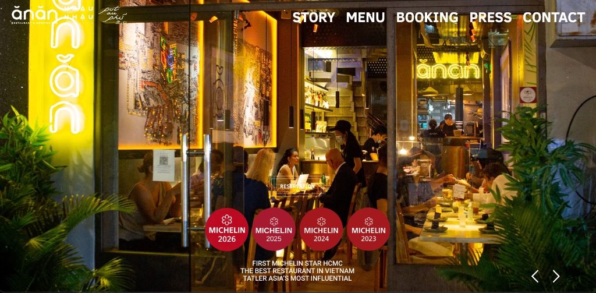

# 🥖 Pâtisserie Dzung — Bánh Mì & Vietnamese Street Food Website

Website chính thức cho nhà hàng ẩm thực đường phố và bánh mì **Pâtisserie Dzung**. Thiết kế lấy cảm hứng từ phong cách thị giác cao cấp của nhà hàng Michelin ĂnĂn Saigon: tone màu tối sang trọng kết hợp ánh đèn vàng neon ấm áp, kính mờ glassmorphism và huy hiệu vinh danh độc đáo.



---

## ✨ Điểm Nổi Bật (Key Features)

- **Hero Slider toàn màn hình**:
  - Không gian đêm Sài Gòn lung linh với ánh đèn vàng neon và góc nhìn qua cửa kính.
  - Các huy hiệu vinh danh phong cách ẩm thực Michelin: *Giòn Tan 2026, Đặc Sản 2025, Top Street 2024, Tươi Sạch 2023*.
  - Nút bấm Đặt bàn (Reservation) và Khám phá menu thiết kế kính mờ (Frosted glass).
- **Thực Đơn Tương Tác (Interactive Menu)**:
  - Lọc theo danh mục: *Bánh Mì Việt Nam, Đồ Ăn Vặt Đường Phố, Món Cuốn Khai Vị, Đồ Uống & Tráng Miệng*.
  - Chi tiết từng món ăn: giá tiền, mô tả nguyên liệu, nhãn *Signature, Best Seller, Chef's Choice*.
  - Nút thêm món nhanh vào danh sách gọi món.
- **Hệ Thống Đặt Bàn (Table Reservation)**:
  - Form đặt bàn trực tuyến: Họ tên, số điện thoại, ngày giờ dùng bữa, số lượng khách, chọn khu vực ngồi (Bàn view kính ngắm phố, bàn sofa trong nhà, quầy bar bếp).
- **Giỏ Gọi Món Nhanh (Quick Order Cart)**:
  - Tính tổng hóa đơn tự động, tăng giảm số lượng món dễ dàng.
- **Tương Thích Mọi Thiết Bị (Fully Responsive)**:
  - Hoạt động mượt mà trên Desktop, Laptop, Tablet và Mobile.
  - Tải trang siêu tốc không cần cài đặt dependencies nặng nề.

---

## 🚀 Hướng Dẫn Xem Thử Trên Máy (Local Preview)

Bạn có thể mở trực tiếp file `index.html` bằng trình duyệt web, hoặc chạy câu lệnh sau trong thư mục dự án:

```bash
# Cách 1: Sử dụng Python có sẵn trên máy
python3 -m http.server 8080

# Sau đó mở trình duyệt truy cập: http://localhost:8080
```

---

## 📤 Hướng Dẫn Đẩy Lên GitHub (`lebachanhtruc`)

### Bước 1: Tạo Repository mới trên GitHub
1. Truy cập vào [https://github.com/new](https://github.com/new).
2. Điền tên Repository: `patisserie-dzung` (hoặc tên tuỳ thích).
3. Chọn trạng thái: **Public** (Công khai).
4. **Không** tích chọn *"Add a README file"* (vì dự án đã có sẵn README).
5. Bấm nút xanh **Create repository**.

### Bước 2: Chạy các lệnh sau trong Terminal tại thư mục này
```bash
# 1. Liên kết với repository vừa tạo trên GitHub
git remote add origin https://github.com/lebachanhtruc/patisserie-dzung.git

# 2. Đổi tên nhánh chính thành main
git branch -M main

# 3. Đẩy toàn bộ mã nguồn lên GitHub
git push -u origin main
```

---

## ⚡ Hướng Dẫn Triển Khai Lên Vercel (Deploy to Vercel)

1. Truy cập vào [https://vercel.com/dashboard](https://vercel.com/dashboard).
2. Bấm nút **"Add New..."** -> Chọn **"Project"**.
3. Bạn sẽ thấy repository `patisserie-dzung` xuất hiện ngay đầu danh sách -> Bấm nút **"Import"**.
4. Ở phần cấu hình: Giữ nguyên mặc định (Framework Preset: *Other*).
5. Bấm **"Deploy"**.

Chỉ sau khoảng 10 giây, website của bạn sẽ online trên toàn thế giới với link có dạng:
`https://patisserie-dzung.vercel.app` 🌍

---

## 📁 Cấu Trúc Mã Nguồn

```
Website Patisserie Dzung/
├── index.html            # Giao diện chính hoàn chỉnh
├── css/
│   └── style.css         # Styling cao cấp, dark gold neon, responsive
├── js/
│   ├── main.js           # Xử lý Slider, Đặt bàn modal, Cart, Scroll
│   └── menu-data.js      # Danh mục món ăn chi tiết
├── assets/
│   └── images/
│       ├── logo.png               # Logo Pâtisserie Dzung chính thức
│       └── hero-anan-reference.jpg # Ảnh hero chuẩn phong cách đêm
├── .gitignore
└── README.md
```

&copy; 2026 Pâtisserie Dzung.
